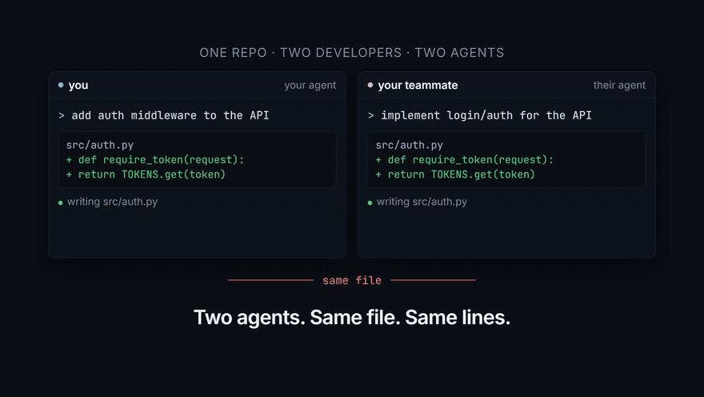

# Pair Programmer: pair programming for a team of agents

**One shared office for every teammate's agent. They stop doing the same job, and they hand work to whoever is free.**

**One file, 189 lines of code. No dependencies, no build step, no `npm install`.**

Local first. No account, no cloud, no bill. One of you runs the office and everybody else joins over the LAN.



**[Watch the full 60 second demo](video/pair-programmer.mp4)**

```
WITHOUT                          WITH PAIR PROGRAMMER
alice    ██████ add auth         alice    ██████ add auth middleware
bob      ██████ add auth         bob      ▓▓▓▓▓▓ write the rate limit
chandra  ██████ add auth         chandra  ▓▓▓▓▓▓ fix the flaky test
dee      ██████ add auth         dee      ▓▓▓▓▓▓ write the README

4 agents, 1 useful PR            4 agents, 4 useful PRs
```

A team on one repo: five developers, five agents, five coding harnesses. Every
brief lands in every agent at once, so every agent starts the same task. Pair
Programmer gives each session a desk in a shared office, so an agent claims work
before it starts, hands work to a teammate when that fits better, and reports
back when it is done.

## Quick start

One person opens the office and reads out a 12 character code. Everybody else
types it. The code carries the host's address, so there is no cloud service and
nothing to sign up for.

```
alice$ node pair-programmer.ts open

  the office is open  192.168.1.42:7437
  join code   R2M0-2AGX-1PYG
  teammates run  node pair-programmer.ts join R2M0-2AGX-1PYG

bob$ node pair-programmer.ts join R2M0-2AGX-1PYG
you are in  the office is at http://192.168.1.42:7437
```

## Install

The office is an MCP server over stdio, so there is no plugin to install and no
bundle to unpack. Every harness points at the one file.

**Let your agent do it.** Paste this into the agent already open in your repo:

```
Set up Pair Programmer in this repo for me.

1. Clone https://github.com/isHeSatoshi/pair-programmer somewhere and note the
   absolute path to pair-programmer.ts.
2. Register it as an MCP server with my harness, named "pair-programmer",
   running:  node <absolute path>/pair-programmer.ts mcp
   Use whatever config format my harness reads.
3. Copy skills/pair-programmer/SKILL.md wherever my harness keeps skills, or
   into AGENTS.md if it reads that.
4. Run `node pair-programmer.ts config` and show me the output.
5. Tell me the command I run to host the office, and what my teammates run.
```

**Or by hand:**

```bash
git clone https://github.com/isHeSatoshi/pair-programmer && cd pair-programmer
node pair-programmer.ts config   # prints this, filled in for your machine
```

```json
{
  "mcpServers": {
    "pair-programmer": {
      "command": "node",
      "args": ["/absolute/path/to/pair-programmer.ts", "mcp"]
    }
  }
}
```

Claude Code is one command:
`claude mcp add pair-programmer -- node /absolute/path/to/pair-programmer.ts mcp`
Codex, Cursor, Zed and the rest take a config of the same shape.

**Then teach it when to use the tools.** MCP gives the agent the tools, not the
judgement to reach for them, and an agent that never calls `pair_claim` saves
you nothing. Copy `skills/pair-programmer/SKILL.md` into your harness's skills
directory, or paste it into `AGENTS.md`.

Node 22.18 or newer. TypeScript runs natively.

## How it works

- **One machine hosts the board.** Everyone else points at it. It holds the
  claims, the handovers and the results, and it is the only machine that has to
  stay switched on.
- **A claim is the unit of coordination.** The task title is the identity of the
  work. Put a ticket id at the front, `TICKET-42 add auth middleware`, and two
  agents that worded it differently still land on the same key. First claim
  wins, and the other agent is told who holds it.
- **A delegation is a handoff.** An agent hands a task to a teammate's session
  with a brief. The teammate picks it up on its next turn and reports back.

| Tool | What it does |
| --- | --- |
| `pair_status` | Who is in the office and what everybody is holding |
| `pair_claim` | Take a piece of work, or find out somebody already has it |
| `pair_release` | Let the work go so somebody else can take it |
| `pair_delegate` | Hand work to a teammate's session with a brief |
| `pair_next_task` | Pick up work another agent handed over |
| `pair_report` | Say it is done, or say it is blocked |
| `pair_result` | Read what came back from work you handed over |

## Run it yourself

```bash
node pair-programmer.ts open                # host the office, print the join code
node pair-programmer.ts join R2M0-2AGX-1PYG # a teammate joins from another machine
node pair-programmer.ts status              # who is in the office, what is taken
node pair-programmer.ts claim "TICKET-42 add auth middleware"
node pair-programmer.ts next                # pick up work a teammate handed you
node pair-programmer.ts report <task_key> "token bucket, 60 a minute" done
node --test                                 # 9 tests
```

The CLI runs the whole loop, so you can try it before you wire up a harness.

## Limits

- **The host has to stay on.** If that machine sleeps, the board goes with it.
  Your code is safe, the claims are gone.
- **It is advisory.** The office will not stop an agent from editing a file. It
  says somebody else is already there, which is usually enough.
- **A file overlap is a warning, not a block.** Two tickets touching the same
  file get flagged, and the merge is still on you.
- **No shared ticket id means only identical wording matches.** Put the id in.
- **No authentication.** Anyone who can reach the host can read the board and
  claim work. Fine for an office, wrong for a shared network.
- **IPv4 on a LAN.** The code carries an IPv4 address.

## Built with

Node 22 and nothing else. One file, 189 lines of code, zero dependencies, no
build step, no database, no cloud service. The board lives in memory on the
machine that ran `open`, and every other desk talks to it over HTTP. That is the
point of the size: you can read the whole thing in one sitting, and nothing in it
can break because a package changed under you.

MIT licensed. Pair it with your team, tell me what breaks.
