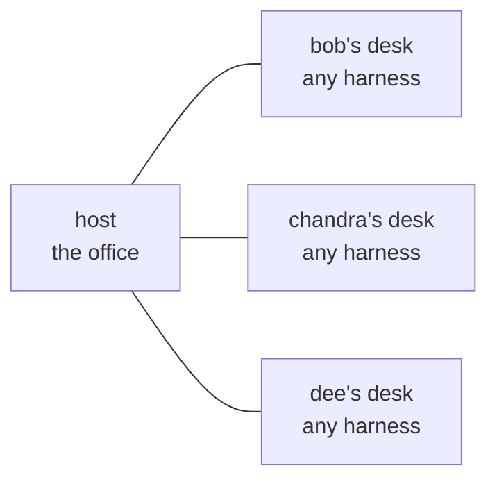

# Pair Programmer: pair programming for a team of agents

**One shared office for every teammate's agent. They stop doing the same job, and they hand work to whoever is free.**

_Local first. No account, no server, no bill. The connection between desks is the LAN._

**Try it: `node pair-programmer.ts demo`** (two desks, one ticket, no duplicated work, about a second)

```
┌──────────────────────────────────────────────────────────────┐
│  WITHOUT PAIR PROGRAMMER                                     │
├──────────────────────────────────────────────────────────────┤
│  alice's agent    ████████████████████  add auth middleware  │
│  bob's agent      ████████████████████  add auth middleware  │
│  chandra's agent  ████████████████████  add auth middleware  │
│  dee's agent      ████████████████████  add auth middleware  │
│                                                              │
│  4 agents. 1 useful PR. 4x the tokens.                       │
└──────────────────────────────────────────────────────────────┘

┌──────────────────────────────────────────────────────────────┐
│  WITH PAIR PROGRAMMER                                        │
├──────────────────────────────────────────────────────────────┤
│  alice's agent    ████████████████████  add auth middleware  │
│  bob's agent      ▓▓▓▓▓▓▓▓▓▓▓▓▓▓▓▓▓▓▓  write the rate limit  │
│  chandra's agent  ▓▓▓▓▓▓▓▓▓▓▓▓▓▓▓▓▓▓▓  fix the flaky test    │
│  dee's agent      ▓▓▓▓▓▓▓▓▓▓▓▓▓▓▓▓▓▓▓  write the README      │
│                                                              │
│  4 agents. 4 useful PRs. The tokens go into work that ships. │
└──────────────────────────────────────────────────────────────┘
```

Hackathon office hours: five people, five agents, five coding harnesses, one
repo. Every brief lands in every agent at the same time, so every agent starts
the same task. Nobody is idle and everybody is duplicating.

Pair Programmer gives each harness session a desk in a shared office. A desk
knows which work is taken and who is free, so an agent claims a task before it
starts, hands a task to a teammate's agent when that is the better fit, and
reports back when it is done. The team moves at the speed of the team instead
of the speed of one agent.

## Connecting is one code

One person opens the office and reads out a 12 character code. Everybody else
types it. That is the whole setup, the same way joining a meeting works.

```
alice$ node pair-programmer.ts open

  the office is open  192.168.1.42:7437

  join code   FW00-00F9-4X70

bob$ node pair-programmer.ts join FW00-00F9-4X70
you are in  the office is at http://192.168.1.42:7437
```

The code carries the address of the host, so there is no server in the middle
and nothing to sign up for. The alphabet has no I, L, O or U in it, so nobody
has to guess whether a character is a one or an O.

## How it works



- **One machine hosts the board.** Everyone else points at it. The board holds
  the claims, the handovers and the results, and the host is the only one that
  has to stay switched on.
- **A claim is the unit of coordination.** The task title decides the identity
  of the work. Put a ticket id at the front, `TICKET-42 add auth middleware`,
  and two agents that worded the ticket differently still land on the same
  key. The first claim wins and the other one is told who holds it.
- **A delegation is a handoff.** An agent hands a task to a teammate's session
  with a brief. The other agent picks it up on its next turn and reports the
  result back.

## Install

```bash
git clone https://github.com/isHeSatoshi/pair-programmer && cd pair-programmer
node pair-programmer.ts install
```

That copies the plugin into `~/.minimax/plugins/pair-programmer`. For any other
harness, the same server speaks MCP over stdio, so paste this into its MCP
config and you are done:

```json
{
  "mcpServers": {
    "pair-programmer": {
      "command": "node",
      "args": ["/path/to/pair-programmer/pair-programmer.ts", "mcp"],
      "env": { "PAIRPROGRAMMER_HARNESS": "claude" }
    }
  }
}
```

Node 22.18 or newer. TypeScript runs natively, so there is no build step, no
`npm install`, and no dependencies at all. Two source files, 379 lines.

## What the agent gets

| Tool | What it does |
| --- | --- |
| `pair_status` | Who is in the office and what everybody is holding |
| `pair_claim` | Take a piece of work, or find out somebody already has it |
| `pair_release` | Let the work go so somebody else can take it |
| `pair_delegate` | Hand work to a teammate's session with a brief |
| `pair_next_task` | Pick up work another agent handed over |
| `pair_report` | Say it is done, or say it is blocked |

The skill tells the agent to check for handed-over work at the start of a turn,
claim before it edits, and stop when a claim comes back as a conflict.

## Run the demo

```bash
node pair-programmer.ts demo      # two desks, one ticket, about a second
node pair-programmer.ts status    # who is here and what they are holding
node --test                       # 10 tests
```

The demo shows two agents get the same ticket, the first one to claim keeps it,
the second one gets told who holds it, and then a third task gets handed over
instead of duplicated.

## Limits

- **The host has to stay on.** If the machine hosting the board sleeps, the
  board goes with it. Everybody else keeps working on their own code.
- **It is advisory.** The office will not stop an agent from editing a file. It
  tells the agent that somebody else is already there, which is usually enough.
- **Without a shared ticket id, only identical wording matches.** The office can
  only tell two tasks apart by the title it was given. Put the ticket id in.
- **No authentication.** Anyone who can reach the host can read the board and
  make claims. Fine for an office, wrong for a shared network.
- **IPv4 on a LAN.** The join code carries an IPv4 address, and a machine that
  blocks UDP broadcast on that segment will not be reachable by code alone.
- **Same files, different tasks, is a warning, not a block.** Two agents can
  still end up in the same file, and merging that is still your problem.

## Built with

Node 22 and nothing else. No dependencies, no database, no server. The board
lives in memory on the host and the desks talk to it over HTTP.

MIT licensed. Build it for your hackathon, tell me what breaks.
